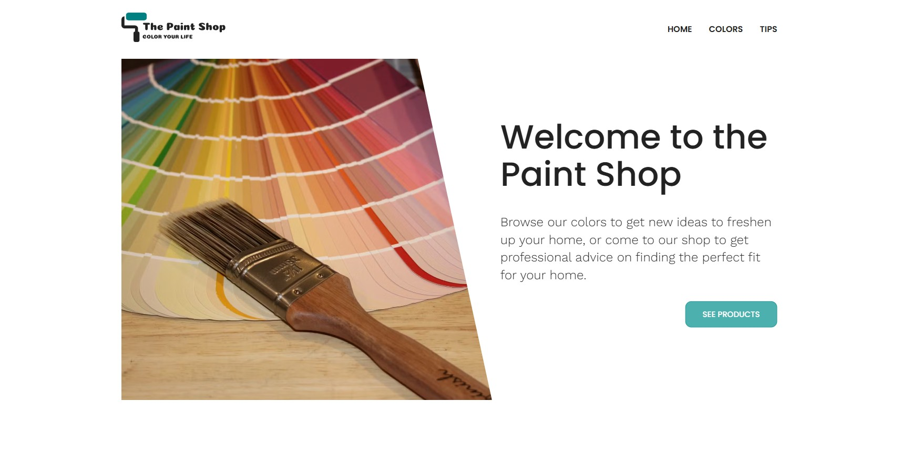
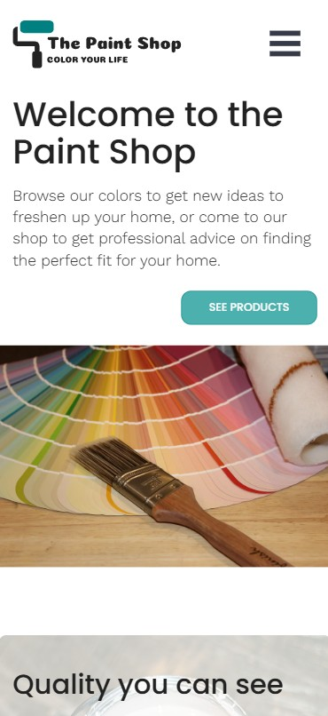

# 🎨 Bachelor Project from KEA

I wanted to create a solution for small businesses that want a personalized dynamic website, the ability to update the content, and add pages after hand-over from the developer.
My solution allows the client to control the content on his site and build new pages with the predefined blocks that are available for each type of page.
  

 
    
    

## How I achieved this

- Create a design system in the form of blocks. Some blocks will have options to get various designs for the same block.
- Set up the structure in Prismic that allows the client to add content.
- Develop the frontend of the project that displays the content from Prismic. 

Check out the project live with Netlify: [https://thepaintshop.netlify.app](https://thepaintshop.netlify.app/)

> Desktop and mobile view.
 

## Stack

Built with Nuxt.js, styled with TailwindCSS, and content managed with Prismic.
